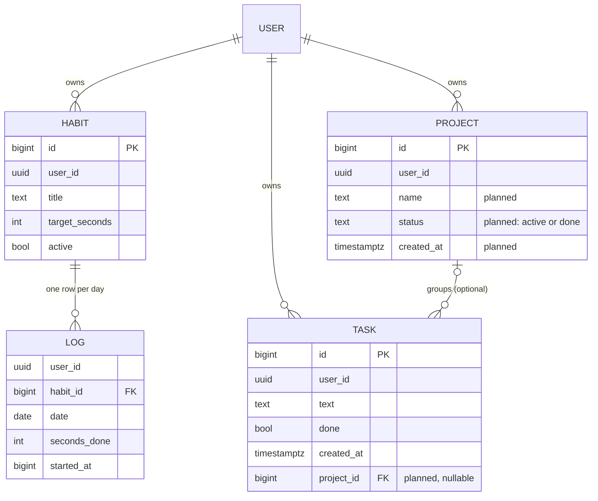
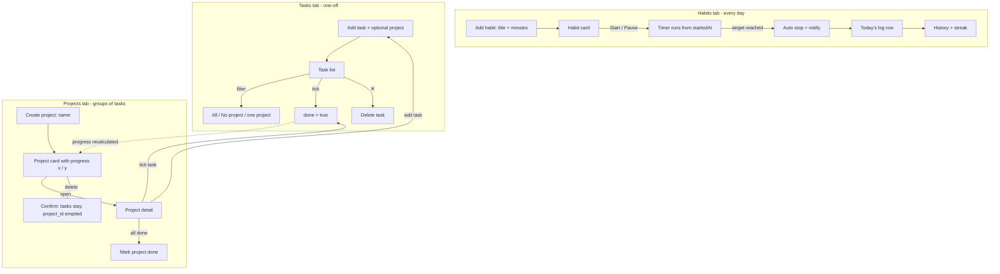
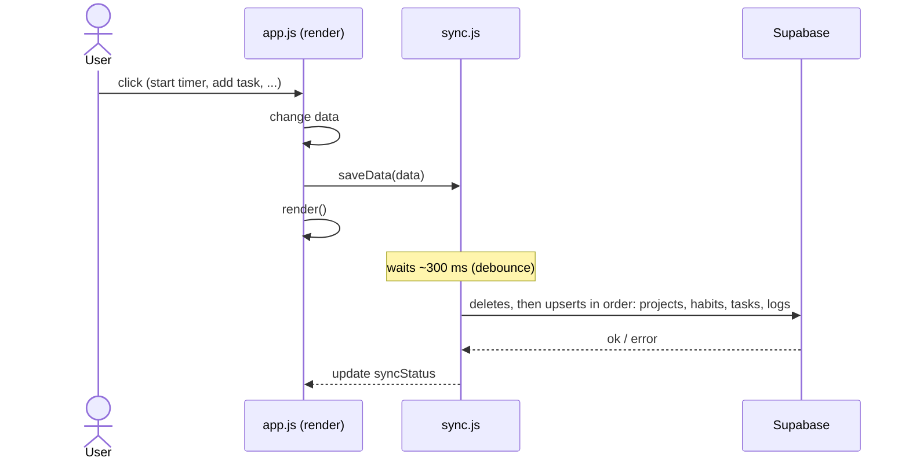
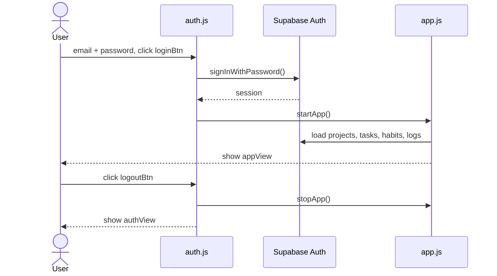
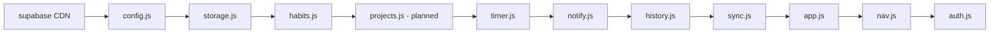

# Daily Tracker – UML

Diagrams are written in [Mermaid](https://mermaid.js.org/). GitHub renders them
automatically when you open this file on github.com, and VS Code shows them with
the "Markdown Preview Mermaid Support" extension (Ctrl+Shift+V to preview).

Add new diagrams as new sections below. Each one goes inside a ```mermaid block.

---

## 1. Data model (ER)

`project_id` on a task is optional: empty means "standalone task".
Deleting a project keeps its tasks and just empties their `project_id`.
Status values marked *planned* are not in the database yet.



---

## 2. The three tabs (flow)



---

## 3. Data flow (sequence)

How a change travels from a click to Supabase.



---

## 4. Login flow (sequence)



---

## 5. Script load order (dependencies)

Scripts are plain `<script>` tags, so each file can only use what was loaded above it.
`projects.js` is planned.


